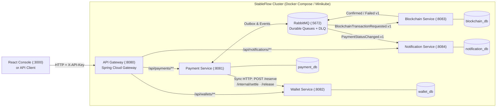
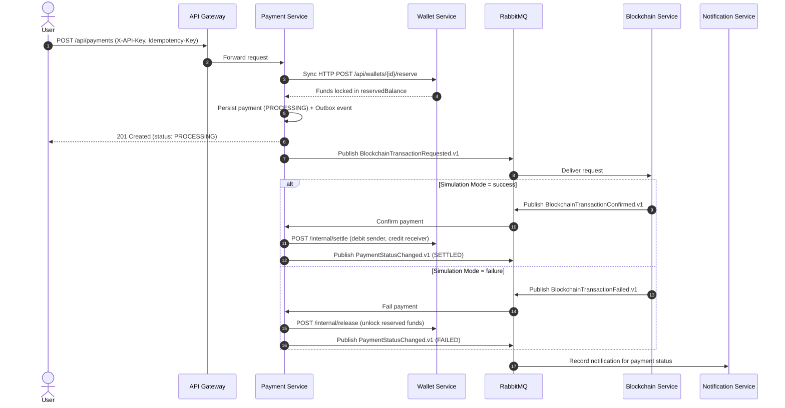

# StableFlow

**StableFlow** is a cloud-native stablecoin (`USDC`) payment, reservation, and settlement platform built with Spring Boot microservices, RabbitMQ event-driven messaging, PostgreSQL database-per-service isolation, Kubernetes (Minikube), and a live React settlement console.

It models real-world fintech reliability patterns: synchronous fund reservation, asynchronous blockchain settlement via the **Transactional Outbox** pattern, idempotent payment & event processing, automatic compensation on failure, and API-key authentication at the edge.

---

## Architecture

StableFlow separates synchronous user-facing operations (gateway routing, balance checks, fund reservation) from asynchronous settlement and notifications over RabbitMQ.



### Payment Lifecycle (Sync + Async)



---

## Key Capabilities

- **Edge Security (`api-gateway`)**: Enforces `X-API-Key` on all `/api/**` routes before forwarding (`401 Unauthorized` on missing/invalid keys), while keeping `/actuator/health` public for Kubernetes probes.
- **Database-per-Service Isolation**: A single PostgreSQL 16 instance hosts four isolated databases (`payment_db`, `wallet_db`, `blockchain_db`, `notification_db`) managed via Flyway migrations.
- **Idempotency & Deduplication**:
  - `POST /api/payments` requires an `Idempotency-Key` header so retries never double-charge.
  - Event consumers deduplicate messages via `processed_events` / database constraints.
- **Transactional Outbox & Resilience**: Payment state and outbound events are committed atomically. If `blockchain-service` or RabbitMQ is temporarily down, payments remain safely in `PROCESSING` with funds reserved and auto-settle once the service recovers.
- **Retry & Dead-Letter Queues**: RabbitMQ consumers retry 3 times with exponential backoff before routing exhausted messages to service-specific DLQs.
- **Live Settlement Console (`frontend/`)**: Light-theme React + TypeScript UI with a persistent **Counterparty & Balances Sidebar** showing real-time `availableBalance`, `reservedBalance`, notification events, Gateway Auth test suite, and an HTTP API Inspector.

---

## Services & API Reference

| Service | Port | Database | Key Endpoints |
|---|---|---|---|
| **api-gateway** | `8080` (NodePort `30080`) | — | Routes `/api/payments/**`, `/api/wallets/**`, `/api/notifications/**`, `/api/blockchain/**`; `/actuator/health` |
| **payment-service** | `8081` | `payment_db` | `POST /api/payments` (`Idempotency-Key`), `GET /api/payments/{paymentId}` |
| **wallet-service** | `8082` | `wallet_db` | `POST /api/wallets`, `GET /api/wallets/{walletId}`, `GET /api/wallets/{walletId}/balance`, `POST /api/wallets/{walletId}/reserve` |
| **blockchain-service** | `8083` | `blockchain_db` | Async simulator (`BLOCKCHAIN_SIMULATION_MODE=success\|failure`, `BLOCKCHAIN_SIMULATION_DELAY_MS=250`) |
| **notification-service** | `8084` | `notification_db` | `GET /api/notifications`, `GET /api/notifications/{notificationId}` |
| **frontend** | `3000` | — | React + Vite console proxying `/api` and `/actuator` to `http://localhost:8080` |

### Authentication

Every `/api/**` request requires the `X-API-Key` header. Local development keys configured in `api-gateway`:

| Key | Intended Client |
|---|---|
| `dev-key-admin` | Manual testing, frontend console, curl |
| `dev-key-payment-service` | Service-to-service / automated calls |

For non-local deployments, set `GATEWAY_API_KEY_1` and `GATEWAY_API_KEY_2` to strong random values (e.g. `openssl rand -hex 32`).

---

## Quick Start

### 1. Start the Backend

Choose either **Docker Compose** (fastest for local dev) or **Minikube** (full Kubernetes deployment + `demo.sh`).

#### Option A: Docker Compose
```bash
docker compose up --build
```
Exposes Gateway on `http://localhost:8080`, PostgreSQL on `5432`, and RabbitMQ Management UI on `http://localhost:15672` (`guest` / `guest`).

#### Option B: Minikube (Kubernetes)
```bash
minikube start --driver=docker --memory=4096 --cpus=3
./infrastructure/minikube/deploy.sh
```
Forward the gateway to `localhost:8080`:
```bash
kubectl port-forward svc/api-gateway 8080:8080 -n stableflow
```

#### Option C: Local Maven Services
```bash
docker compose up -d postgres rabbitmq
mvn -pl wallet-service spring-boot:run
mvn -pl payment-service spring-boot:run
mvn -pl blockchain-service spring-boot:run
mvn -pl notification-service spring-boot:run
mvn -pl api-gateway spring-boot:run
```

### 2. Start the Frontend Console

```bash
cd frontend
npm install
npm run dev
```
Open **`http://localhost:3000`**.

From the UI you can:
1. Click **Quick Setup: Alice (500) & Bob (0.000001)** in the right sidebar.
2. Submit a `USDC` payment and watch the live lifecycle (`PROCESSING` → `SETTLED`), Bob's balance increment in real time, and the notification appear in the **Events** tab.
3. Run the **Demo 2 — Gateway Authentication Suite** and inspect every HTTP request in the **API Inspector**.

---

## Automated Verification & Demos

### End-to-End Kubernetes Demo (`demo.sh`)
With Minikube running and deployed:
```bash
./demo.sh
```
Runs 20 automated checks covering:
1. Minikube 7-pod deployment & ClusterIP isolation
2. Gateway `X-API-Key` enforcement (`401` on missing/wrong key, `200` on `/actuator/health`)
3. Per-service database isolation (`payment_db`, `wallet_db`, `blockchain_db`, `notification_db`)
4. Sync HTTP reservation + 3-hop async RabbitMQ settlement
5. Resilience: scaling `blockchain-service` to `0`, accepting a payment into the outbox, scaling back to `1`, and verifying automatic settlement

### Unit & Integration Tests
```bash
mvn test
```

### Load Testing (k6)
Run the successful-payment workload at increasing concurrency:
```bash
k6 run -e BASE_URL=http://localhost:8080 -e VUS=10 load-testing/k6/payment-flow.js
k6 run -e BASE_URL=http://localhost:8080 -e VUS=25 load-testing/k6/payment-flow.js
k6 run -e BASE_URL=http://localhost:8080 -e VUS=50 load-testing/k6/payment-flow.js
k6 run -e BASE_URL=http://localhost:8080 -e VUS=100 load-testing/k6/payment-flow.js
```
Run the failed-payment compensation workload (with `BLOCKCHAIN_SIMULATION_MODE=failure`):
```bash
k6 run -e BASE_URL=http://localhost:8080 -e VUS=10 load-testing/k6/failed-payments.js
```
Recorded local results are in [load-testing/results/2026-11-12-local.md](load-testing/results/2026-11-12-local.md), with a template at [load-testing/REPORT_TEMPLATE.md](load-testing/REPORT_TEMPLATE.md).

---

## Project Structure

```text
stableFlow/
├── api-gateway/           # Spring Cloud Gateway + X-API-Key security filter
├── payment-service/       # Payment orchestration, outbox publisher, RabbitMQ listener
├── wallet-service/        # Wallet balances, fund reservation, settle/release
├── blockchain-service/    # Simulated on-chain confirmation/failure worker
├── notification-service/  # Payment status event consumer & query API
├── frontend/              # React + TypeScript + Vite settlement console
├── k8s/                   # Kubernetes manifests (namespace, secrets, deployments)
├── infrastructure/
│   ├── minikube/          # Minikube image build & rollout script
│   └── postgres/          # Multi-database initialization SQL
├── load-testing/          # k6 scripts and benchmark reports
├── docker-compose.yml     # Full local container stack
└── demo.sh                # 20-check interactive Kubernetes demo script
```
